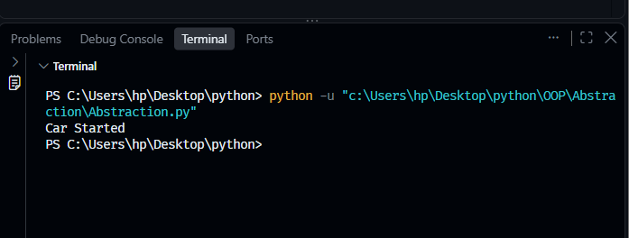
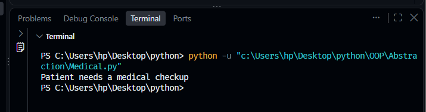

# 14. Object-Oriented Programming: Abstraction 🐍

Welcome to my fourteenth Python learning milestone! This repository covers **Abstraction**, a core pillar of Object-Oriented Programming (OOP) used to hide complex implementation details and only show the essential feature blueprints to the user.

## 🛠️ Concepts & Programs Covered

* **`Abstraction.py`** — Fundamental implementation of abstract base classes using Python's built-in `abc` module to establish core interface rules for tracking software components.
* **`Medical.py`** — Implementing an abstract `Medical` base class with an enforcing `@abstractmethod` decorator to ensure that the subclass `Patient` overrides and executes its own explicit `treatment()` routine.

---

## ⚙️ Core OOP Mechanics Covered
1. **Abstract Base Classes (ABC)**: Utilizing `from abc import ABC, abstractmethod` to design structure skeletons that cannot be instantiated directly.
2. **Interface Enforcements**: Employing the `@abstractmethod` decorator to force child classes to build custom matching configurations, preventing incomplete runtime configurations.
3. **Complexity Reduction**: Isolating base program rules from executable child components to simplify code architectures.

---

## 🖥️ Terminal Output Verifications

### 📊 1. Base Class Template Interface Result
Below is the successful environment verification demonstrating abstract enforcement logic validations and functional console prints:

### 🏥 2. Medical Patient Blueprint Execution Result
Below is the validated terminal verification showcasing structural child class implementation running flawlessly:

