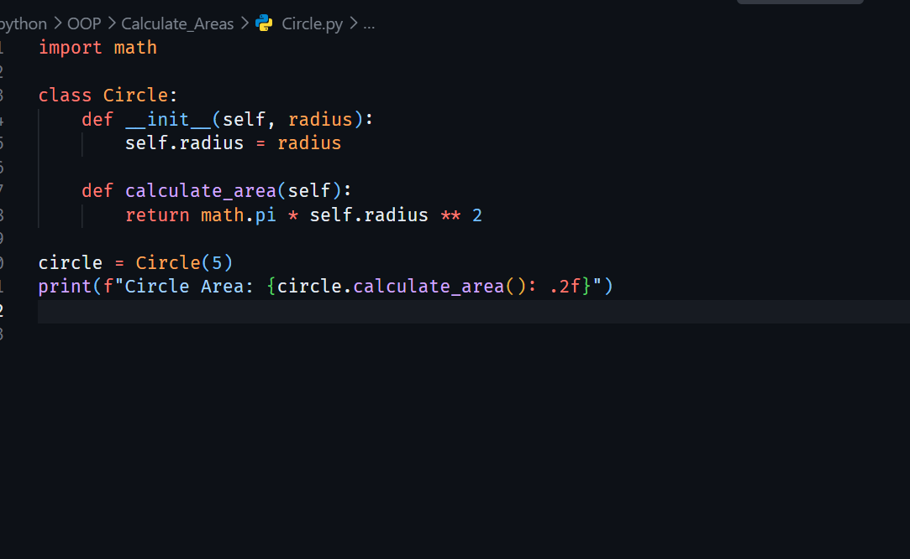
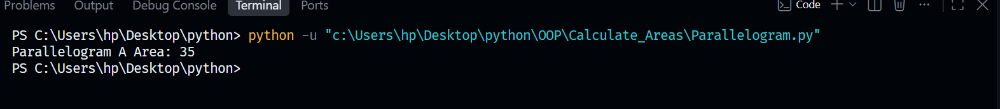
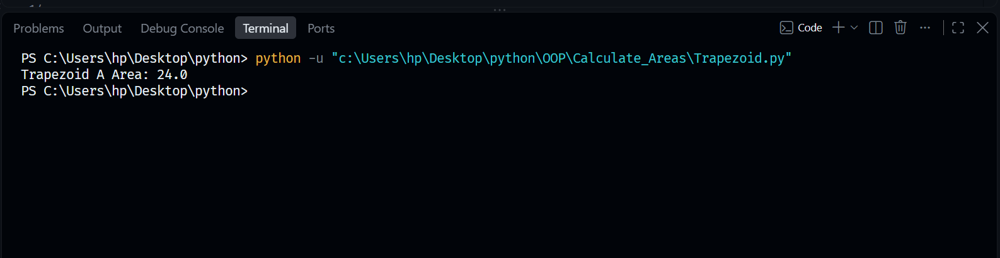

# Calculate Areas

This folder contains practical implementations of geometric area calculations using object-oriented programming (OOP) principles in Python. Each shape is structured as a class with encapsulating attributes and computational methods.

## Files Included
* `Circle.py`: A script defining a Circle class that uses the radius attribute and Python's math module to calculate circular area.
* `Parallelogram.py`: A script defining a Parallelogram class that uses base and height attributes to calculate surface area.
* `Trapezoid.py`: A script defining a Trapezoid class that uses parallel bases and height attributes to calculate area based on averaging properties.

## Core Concepts Covered
1. **Object-Oriented Programming**: Utilizing classes, constructors (`__init__`), and instances to model geometric structures.
2. **Encapsulation**: Storing specific dimension parameters directly within object properties.
3. **Mathematical Implementations**: Using Python's built-in math utilities and equations for clean algorithmic outputs.

## Visual Diagrams
Below are the geometric reference models mapped for this module:

