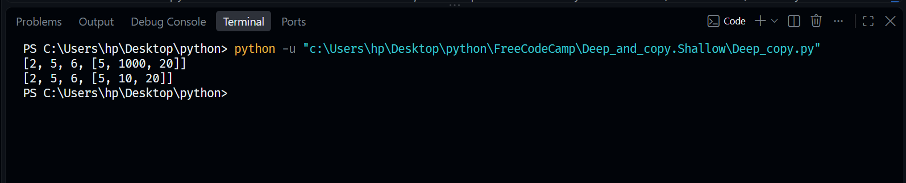

# Deep and Shallow Copying

This folder contains practical implementations demonstrating the critical differences between shallow and deep copying techniques in Python when dealing with nested data structures.

## Files Included
* `Deep_copy.py`: Scripts illustrating reference sharing in shallow copies versus total memory isolation using deep copies.

## Core Concepts Covered
1. **Shallow Copy**: Creating a new outer container that shares internal memory addresses (references) for nested objects. Modifying a nested child impacts the original structure.
2. **Deep Copy**: Recursively cloning both outer containers and inner nested elements into brand-new, isolated memory spaces to preserve data independence.
3. **The `copy` Module**: Utilizing built-in library methods like `copy.deepcopy()` to handle complex, nested collections safely.

## Visual Diagrams
Below are the conceptual flowcharts mapped for this module:

