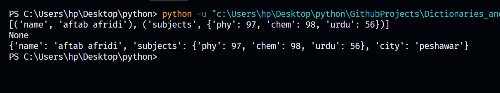
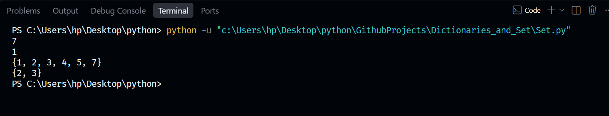

# 02. Dictionaries and Sets 🐍

Welcome to my second Python learning repository! This milestone covers key-value data structures (Dictionaries) and unique collection types (Sets) along with their core operations.

## 🛠️ Concepts & Programs Covered
* `Dictionary.py` — Storing data in key-value pairs, accessing values, updating elements, and using built-in dictionary methods.
* `Set.py` — Creating unordered collections of unique items, adding/removing values, and performing set operations like unions and intersections.

---

## 🖥️ Terminal Output Verifications

### 📊 1. Dictionaries Execution
Below is the successful terminal confirmation displaying key-value tracking and dictionary manipulations:

### 🛣️ 2. Set Operations Logical Flow Execution
Below is the validated environment testing confirmation for handling unique sets data and operations:

