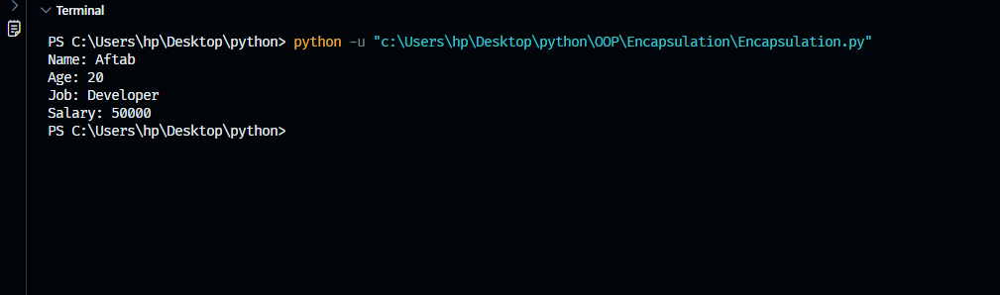

# 13. Object-Oriented Programming: Encapsulation 🐍

Welcome to my thirteenth Python learning milestone! This repository covers **Encapsulation**, an essential Object-Oriented Programming (OOP) pillar that involves bundling data (attributes) and methods into a single unit (class) while restricting direct access to prevent accidental modification.

## 🛠️ Concepts & Programs Covered

* **`Encapsulation.py`** — Implementing private attributes (using double underscores like `__salary`) and restricted internal class validation methods to securely gate employee records, profiles, and salary displays.

---

## ⚙️ Core OOP Mechanics Covered
1. **Data Hiding**: Restricting direct external access to variables by prefixing them with double underscores (`__`), changing how Python handles the variable name internally.
2. **Access Methods**: Creating dedicated public getter/setter styles or class methods (like `display()`) to control how private variable scopes are safely printed or modified.
3. **Internal Helper Logic**: Utilizing internal reference pointers (such as `self.show_salary()`) to run calculations securely from inside the class execution layer.

---

## 🖥️ Terminal Output Verifications

### 📊 1. Data Encapsulation and Attribute Restriction Result
Below is the successful environment verification demonstrating profile instantiation, secure state management, and formatted console data prints:

