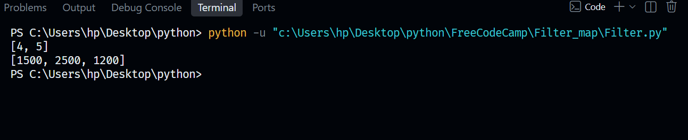
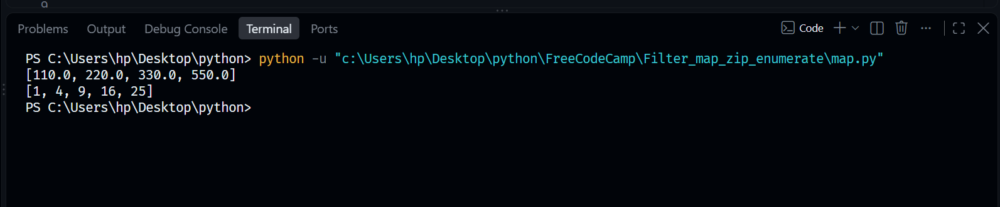
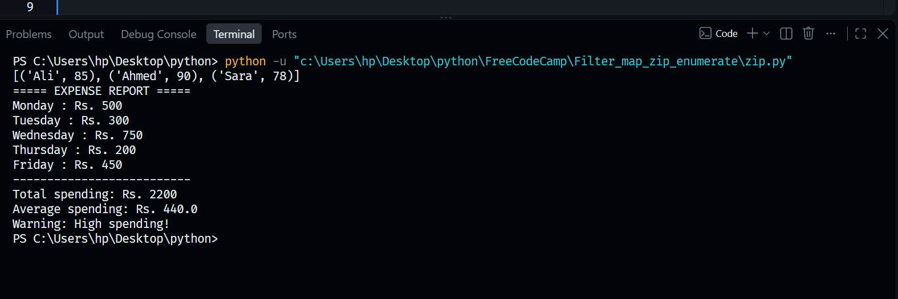
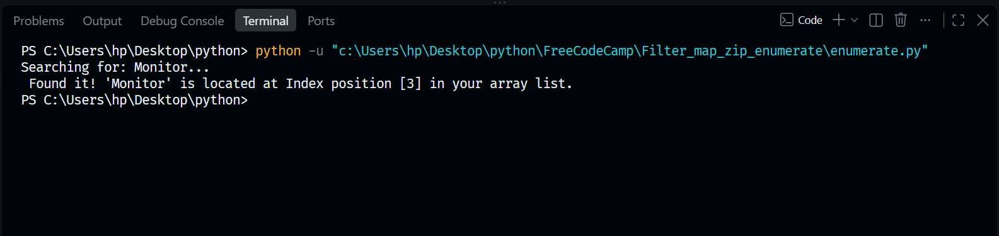

# Filter, Map, and Zip Operations

This folder contains practical implementations of Python built-in functions used for data transformation, collection filtering, and parallel sequence iteration.

## Files Included
* `Filter.py`: Scripts demonstrating how to extract elements from a collection based on conditional criteria.
* `map.py`: Scripts demonstrating how to apply a specific transformation function to every item in a sequence simultaneously.
* `zip.py`: Scripts demonstrating how to combine multiple iterables into a single sequence of tuples.
* `enumerate.py`: Scripts demonstrating how to iterate through collections while automatically tracking item index positions.

## Core Concepts Covered
1. **Filtering Data**: Utilizing functional approaches to discard or keep elements dynamically.
2. **Mapping Data**: Efficiently modifying entire datasets without writing manual loops.
3. **Zipping Sequences**: Pairing corresponding data points from separate lists or tuples side-by-side.
4. **Enumerating Iterables**: Generating counters alongside collection values during active loops.

## Visual Diagrams
Below are the conceptual references mapped for this module:

