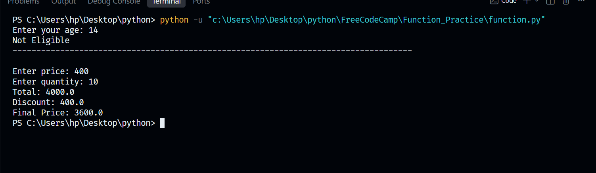
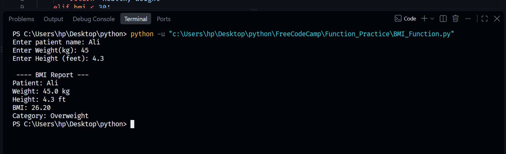
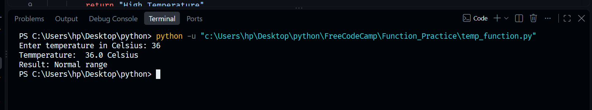
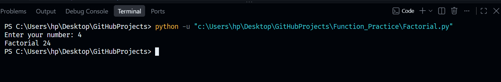
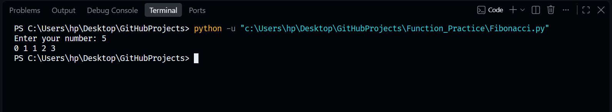

# Function Practice

This folder contains practical implementations of custom Python functions, focusing on parameter passing, logical operations, dictionary manipulation, and reusable calculations.

## Files Included
* `function.py`: Core examples exploring structural basics, user age validation checks, and total calculation workflows utilizing positional parameters.
* `BMI_Function.py`: A script calculating Body Mass Index using patient metrics and functional categorization rules based on calculated output ranges.
* `temp_function.py`: A script evaluating Celsius temperature scales to categorize clinical body temp states using clean conditional blocks.
* `test_settings.py`: A configuration management panel demonstrating structured dictionary manipulation through custom functional workflows to add, update, delete, and view settings securely.
* `Factorial.py`: A script demonstrating mathematical recursion and iterative workflows to compute the product of an integer sequence.
* `fibonacci.py`: A script demonstrating mathematical recursion and iterative workflows to generate the Fibonacci sequence up to a specified limit.

## Core Concepts Covered
1. **Modular Logic**: Utilizing the def keyword to break down complex scripts into independent, reusable functional units.
2. **Parameters and Return Operations**: Passing dynamic arguments into functions to return calculated outcomes cleanly back to the caller scope.
3. **Data Structure Interaction**: Integrating dictionaries with custom functions to securely read, update, and manage persistent key-value configuration flags.

## Visual Diagrams
Below are the conceptual flowcharts mapped for this module:

