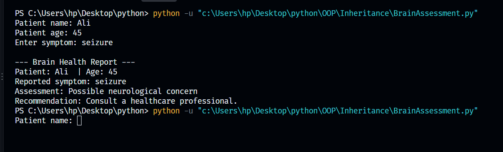

# OOP Inheritance

This folder implements Object-Oriented Programming (OOP) inheritance models to structure scalable, reusable code modules.

## 👥 Implemented Classes
* **`Inheritance.py`**: Demonstrates baseline inheritance mechanics using a parent `Parent` class and a derived `Child` class.
* **`BrainAssessment.py`**: Implements a real-world medical data pattern using a parent `Patient` class and a specialized `BrainAssessment` child class.

## 🧠 Core Concepts
* **Class Hierarchies**: Distributing functional methods cleanly from base parent structures down to specialized child classes.
* **Method Overriding**: Redefining baseline inherited logic to deliver unique child class functionality.
* **Constructor Chaining**: Invoking the parent state safely using Python's native `super().__init__()` interface.

## 📊 Visual Diagrams
Below is the system logic chart mapped for this module:

