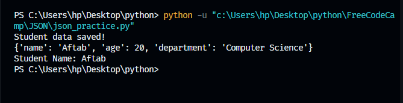
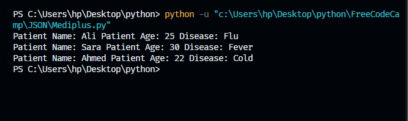

# 15. JSON Processing 🐍

This repository covers **JSON Data Serialization** to store, read, and exchange structured data using Python's built-in `json` module.

## 📁 Files Covered

* **`json_practice.py`** — Writing and loading patient/student datasets using persistent files.
* **`Mediplus.py`** — Managing application logic and interface configurations.

---

## ⚙️ Core Functions

| Function | Purpose |
| :--- | :--- |
| `json.dump()` | Writes Python data to a JSON file. |
| `json.load()` | Reads data from a JSON file. |
| `json.dumps()`| Converts Python data into a JSON string. |
| `json.loads()`| Converts a JSON string into Python data. |

---

## 🖥️ Verifications

### 📊 1. JSON Practice Output

### 🏥 2. Mediplus Output

