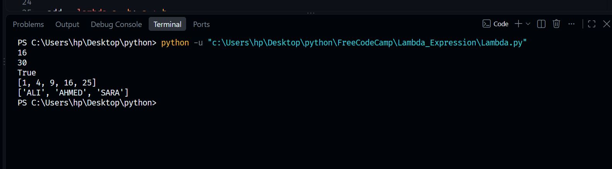
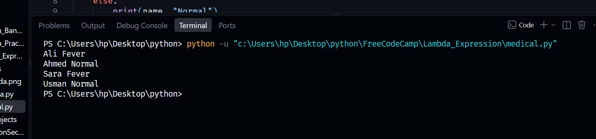

# Lambda Expressions Practice

This folder contains practical implementations of Python **anonymous functions (lambda expressions)**, focusing on concise data transformations, mapping operations, and inline conditional filtering.

## Files Included
* `Lambda.py`: Core examples exploring fundamental functional operations, mathematical sequences, boolean filtering, and sequence mapping with `map()`.
* `medical.py`: A script using conditional lambdas paired with `zip()` to iterate through parallel client arrays and evaluate patient metrics based on temperature thresholds.

## Core Concepts Covered
1. **Anonymous Functions**: Utilizing the `lambda` keyword to define single-line, lightweight functions without standard named structural definitions.
2. **Iterable Data Mapping**: Combining lambda expressions with `map()` to dynamically transform numerical arrays and string data types instantly.
3. **Parallel Sequence Iteration**: Processing zip matrices alongside an evaluation lambda function to handle distinct multi-variable conditions smoothly.

## Visual Diagrams
Below are the conceptual flowcharts mapped for this module:

