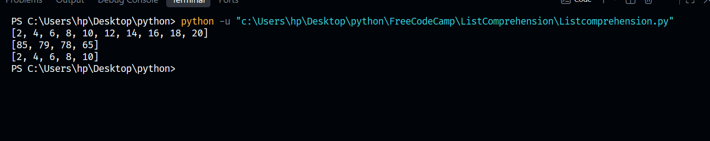

# List Comprehension

This folder contains practical implementations of list comprehensions in Python, focusing on writing clean, concise, and efficient code for list creation and data processing.

## Files Included
* `ListComprehension.py`: Scripts demonstrating how to create, transform, and filter lists using single-line expressions instead of traditional loops.

## Core Concepts Covered
1. **Concise Syntax**: Generating new lists efficiently by replacing multi-line `for` loops and `.append()` blocks with a single bracket expression.
2. **Data Transformation**: Applying mathematical operations directly to sequence items during generation (e.g., doubling ranges of numbers).
3. **Conditional Filtering**: Using trailing `if` statements to filter collection elements selectively based on specific criteria (e.g., extracting passing grades or even numbers).

## Visual Diagrams
Below are the conceptual flowcharts mapped for this module:

