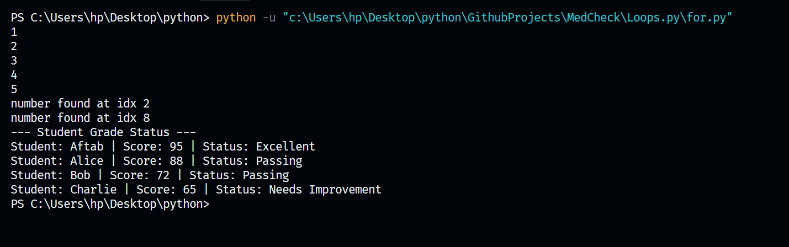
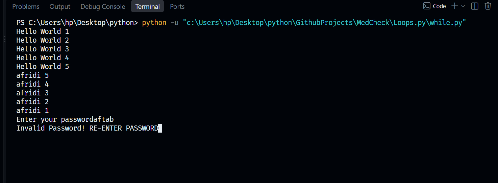
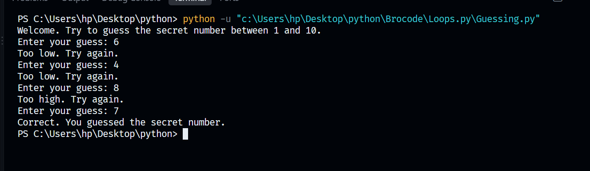

# Loops and Conditionals

This folder contains practical implementations of control flow structures in Python, focusing on decision-making logic and iteration techniques.

## Files Included
* `for.py`: Scripts demonstrating how to iterate through sequences cleanly using for loops.
* `while.py`: Scripts demonstrating how to control dynamic program execution using while loops.
* `Guessing.py`: A simple guessing game that uses conditional logic to process user input.

## Core Concepts Covered
1. **For Loops**: Iterating through collection data structures to process items sequentially.
2. **While Loops**: Running a block of code continuously as long as a specified condition remains true.
3. **Conditional Logic**: Using if, elif, and else statements to guide program execution based on user inputs.

## Visual Diagrams
Below are the conceptual flowcharts mapped for this module:

