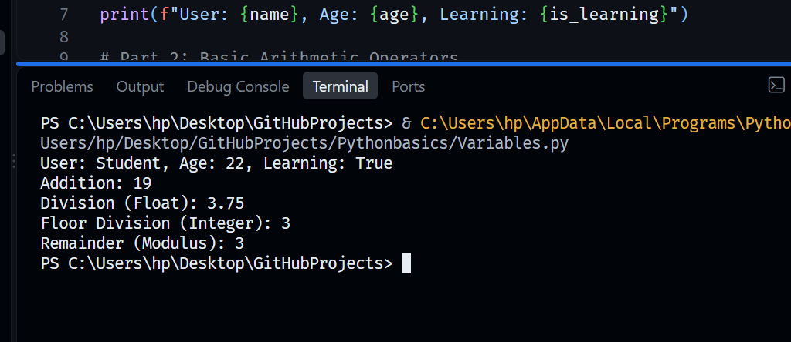

# 01. Python Basics 🐍

Welcome to my Python learning and tracking repository! This initial milestone contains my foundational files covering variable operations, arithmetic calculations, and conditional control logic.

## 🛠️ Concepts & Programs Covered

### 1. Variables & Operators (`Variables.py`)
- Initializing data types including Strings, Integers, and Booleans.
- Implementing math operators like standard division, floor division, and modulus.

### 2. Conditional Routing (`If.py`)
- Capturing dynamic user input from the console using `input()`.
- Building decision-making structures using `if`, `elif`, and `else` gates.

---

## 🖥️ Terminal Output Verifications

### 📊 1. Variables and Operators Execution
Below is the successful execution confirming data operations and remainder calculations:

### 🛣️ 2. If-Else Logical Flow Execution
Below is the validated environment testing confirmation for user validation paths:

