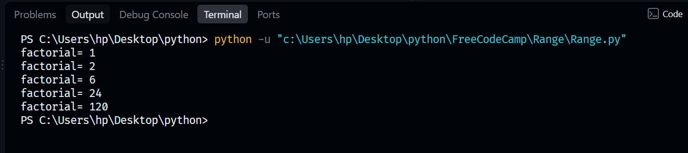
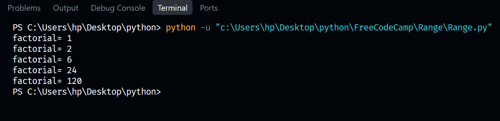

# 04. Python Range Function 🐍

Welcome to my fourth Python learning repository! This milestone covers sequence generation using the built-in `range()` function, iterating through numerical bounds, and converting ranges into structural data lists.

## 🛠️ Concepts & Programs Covered
* `Range.py` — Utilizing the `range()` function to loop through numerical limits with custom start, stop, and step intervals.
* `Range_List.py` — Combining sequence generation loops with arrays to dynamically populate and output numerical list structures.

---

## 🖥️ Terminal Output Verifications

### 📊 1. Range Sequence Iteration Execution
Below is the successful terminal confirmation displaying the execution of numerical range sequence patterns:

### 🛣️ 2. Dynamic Range List Generation
Below is the validated environment testing confirmation displaying the successful extraction of range data into a completed Python list array:

