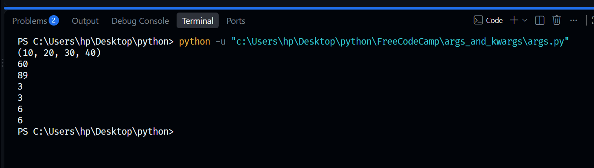
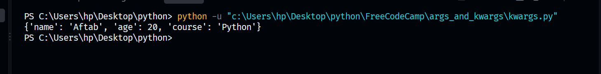
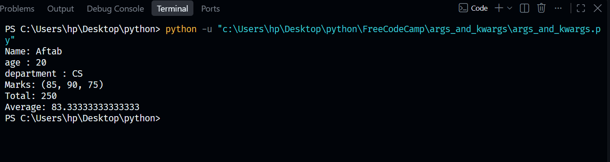

#  Special Arguments: *args and **kwargs 🐍
This milestone covers advanced function parameters, specifically focusing on passing variable-length positional arguments (`*args`) and keyword arguments (`**kwargs`) dynamically into Python functions.

## 🛠️ Concepts & Programs Covered
* `args.py` — Utilizing `*args` to pass a dynamic, variable-length tuple of non-keyword arguments into a function without predefining parameter counts.
* `kwargs.py` — Implementing `**kwargs` to pass flexible dictionary fields (key-value pairs) dynamically into customized functions.
* `args_and_kwargs.py` — Combining both `*args` and `**kwargs` inside a single, unified function structure to handle mixed variable-length inputs seamlessly.

---

## 🖥️ Terminal Output Verifications

### 📊 1. Variable-Length Non-Keyword Arguments (*args) Execution
Below is the successful terminal confirmation displaying the execution of flexible tuple arguments:

### 🛣️ 2. Variable-Length Keyword Arguments (**kwargs) Execution
Below is the validated environment testing confirmation displaying dynamic key-value dictionary parameter parsing:

### 🚀 3. Combined Function Execution Profile
Below is the execution confirmation demonstrating both parameter types working perfectly together from the `args_and_kwargs.py` program:

